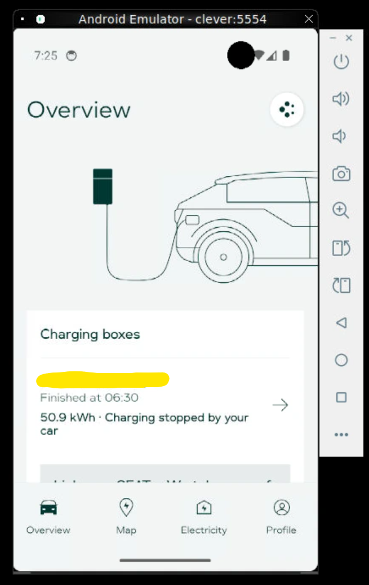

# Clever-integration til Home Assistant

Home Assistant-integration til **Clever**-ladebokse. Dette er en **uofficiel integration** - ikke noget Clever selv leverer eller understøtter. Den virker ved at efterligne de kald, som Clevers egen app foretager, da der ikke findes et offentlig API.

## ⚠️ Læs dette først

- Integrationen taler med de samme private og udokumenterede endpoints som Clevers app bruger. De kan blive ændret eller lukket ned uden varsel.
- Dette repository bliver ikke opdateret, med mindre udvikleren finder fejl og løser dem selv, eller hvis andre laver pull requests med rettelser. Dette projekt er udelukkende udgivet, så andre kan få glæde af det.
- Kun testet på P40 ladeboks.

## Entiteter

| Entitet | Beskrivelse |
|---|---|
| `time.departure_time` - Afgangstidspunkt | Hvornår bilen skal være færdigopladet (rundes til nærmeste 5 min.) |
| `number.power_required` - Ønsket energi | Ønsket energimængde til afgang, 0–80 kWh |
| `select.smart_charging` - Smart opladning | Aktivér / Deaktiver 1 time / Deaktiver 3 timer / Deaktiver indtil fuldt opladet |
| `sensor.status` - Status | Ladeboksens driftsstatus |
| `sensor.model` - Model | Ladeboksens model |
| `sensor.phase_count` - Faseantal | Antal faser boksen lader på |
| `sensor.ampere` - Ampere | Maks. strømstyrke |
| `sensor.last_seen` - Sidst set | Hvornår boksen sidst kontaktede Clever |
| `binary_sensor.online` - Online | Om boksen er online |

Kræver den valgfrie **emulator tilføjelse** (se nedenfor):

| Entitet | Beskrivelse |
|---|---|
| `sensor.live_charging_status` - Opladningsstatus | Rå ladestatus for den aktuelle session |
| `sensor.live_energy_delivered` - Leveret energi | Energi leveret i den aktuelle session |
| `sensor.live_estimated_finish_time` - Estimeret sluttidspunkt | Hvornår opladningen forventes færdig |
| `sensor.live_session_started_at` - Session startet | Hvornår den aktuelle session startede |
| `sensor.live_status_message` - Statusbesked | Samme statusbesked som vises i Clever-appen |
| `binary_sensor.is_charging` - Oplader | Om bilen oplader lige nu |
| `binary_sensor.live_stop_requested` - Stop anmodet | Om opladningen blev stoppet manuelt (f.eks. fra bilen) |

## Begrænsninger

- **Ingen live ladestatus uden emulator tilføjelsen.** Clevers almindelige API fortæller ikke om bilen oplader lige nu, eller hvor meget energi der er leveret i den aktuelle session.
- **`select.smart_charging` er optimistisk uden emulator tilføjelsen.** Den husker kun den seneste kommando *du* har sendt fra Home Assistant - ikke boksens faktiske tilstand. Ændres smart opladning fra Clever-appen selv, eller udløber en midlertidig deaktivering af sig selv, opdager Home Assistant det ikke uden emulator tilføjelsen.

## Installation

HACS understøttes ikke endnu - installer manuelt:

1. Kopiér indholdet af [`custom_components/clever`](custom_components/clever) ind i din Home Assistant `config/custom_components/clever` mappe.
2. Genstart Home Assistant.
3. Gå ind i Indstillinger → Enheder og tjenester → Tilføj integration → søg efter "Clever".
4. Indtast din Clever-kontos email og adgangskode.
5. Sæt eventuelt flueben ved "Brug live-status-tilføjelsen" og indtast dens URL - kun hvis du
   allerede har sat [docker-tilføjelsen](docker) op (se nedenfor). Helt valgfrit, og kan
   slås til/fra senere via integrationens "Konfigurér"-knap.

## Emulator live-status-tilføjelse (valgfri, kun x86-64 indtil videre)

Clever-appen kan vise live ladestatus (oplader eller ej, varighed, leveret energi). For at kunne vise det i Home Assistant, skal der køre en Android emulator med appen åben, hvor der sidder et man-in-the-middle script, der holder øje med trafikken mellem Clever app og Google Firebase. Dette er en teknisk begrænsning.

Dette er **helt valgfrit** - resten af integrationen virker fuldt ud uden det, blot uden live-data om den aktuelle ladesession. Se [`docker/README.md`](docker/README.md) for fuld opsætning. Kort fortalt kræver det:

- En x86-64 Linux maskine der kan stå tændt permanent, som bruger **4-5 GB RAM** hele tiden, uanset belastning. ARM (eksempelvis Raspberry Pi) er **IKKE** understøttet.
- Et **engangs interaktivt login** via noVNC i browseren - herefter forbliver du logget ind på tværs af genstart.
- At du selv henter Clever-appens APK-filer fra din egen telefon eller nettet - de kan ikke distribueres
  i dette repo, se [`docker/apks/README.md`](docker/apks/README.md).

Jeg er klar over dette er en irriterende måde at køre det på, men eftersom Clever ikke selv har et åbent API, er dette desværre den eneste mulighed lige nu.