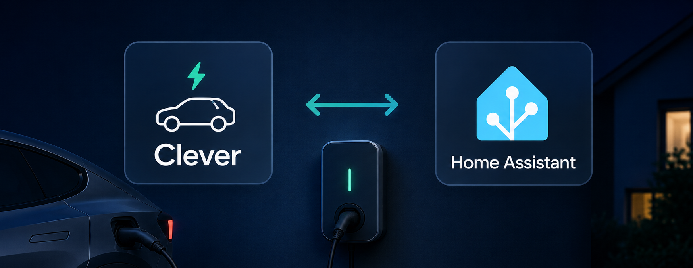
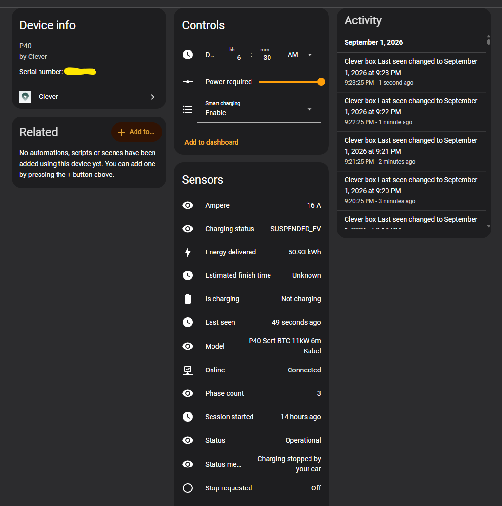

# Clever-integration til Home Assistant

Home Assistant-integration til **Clever**-ladebokse. Dette er en **uofficiel integration** - ikke noget Clever selv leverer eller understøtter. Den virker ved at efterligne de kald, som Clevers egen app foretager, da der ikke findes et offentlig API.

## ⚠️ Læs dette først

- Integrationen taler med de samme private og udokumenterede endpoints som Clevers app bruger. De kan blive ændret eller lukket ned uden varsel.
- Dette repository bliver ikke opdateret, med mindre udvikleren finder fejl og løser dem selv, eller hvis andre laver pull requests med rettelser. Dette projekt er udelukkende udgivet, så andre kan få glæde af det.
- Kun testet på P40 ladeboks.

## Entiteter

Alle entiteter virker med blot din Clever-konto - der kræves ingen ekstra opsætning.

| Entitet | Beskrivelse |
|---|---|
| `time.departure_time` - Afgangstidspunkt | Hvornår bilen skal være færdigopladet (rundes til nærmeste 5 min.) |
| `number.power_required` - Ønsket energi | Ønsket energimængde til afgang, 0–80 kWh |
| `select.smart_charging` - Smart opladning | Aktivér / Deaktiver 1 time / Deaktiver 3 timer / Deaktiver indtil fuldt opladet |
| `sensor.status` - Status | Ladeboksens driftsstatus |
| `sensor.model` - Model | Ladeboksens model |
| `sensor.phase_count` - Faseantal | Antal faser boksen lader på |
| `sensor.ampere` - Ampere | Maks. strømstyrke |
| `sensor.last_seen` - Sidst set | Hvornår boksen sidst kontaktede Clever |
| `binary_sensor.online` - Online | Om boksen er online |
| `sensor.live_charging_status` - Opladningsstatus | Rå ladestatus for den aktuelle session |
| `sensor.live_energy_delivered` - Leveret energi | Energi leveret i den aktuelle session |
| `sensor.live_estimated_finish_time` - Estimeret sluttidspunkt | Hvornår opladningen forventes færdig |
| `sensor.live_session_started_at` - Session startet | Hvornår den aktuelle session startede |
| `sensor.live_status_message` - Statusbesked | Samme statusbesked som vises i Clever-appen |
| `binary_sensor.is_charging` - Oplader | Om bilen oplader lige nu |
| `binary_sensor.live_stop_requested` - Stop anmodet | Om opladningen blev stoppet manuelt (f.eks. fra bilen) |

## Live-ladestatus

Clever-appen viser live ladestatus (oplader eller ej, varighed, leveret energi, smart
opladnings-plan). Integrationen henter de samme data automatisk hvert 10. sekund, så de
også kan ses i Home Assistant.

## Begrænsninger

- **`select.smart_charging` afspejler boksens faktiske tilstand under en aktiv
  ladesession.** Uden en aktiv session er den optimistisk: den husker kun den seneste
  kommando *du* har sendt fra Home Assistant - ikke boksens faktiske tilstand.

## Installation

HACS understøttes ikke endnu - installer manuelt:

1. Kopiér indholdet af [`custom_components/clever`](custom_components/clever) ind i din Home Assistant `config/custom_components/clever` mappe.
2. Genstart Home Assistant.
3. Gå ind i Indstillinger → Enheder og tjenester → Tilføj integration → søg efter "Clever".
4. Indtast din Clever-kontos email og adgangskode.

Det er alt - live-ladestatus virker med det samme, ingen ekstra opsætning.

## Ændringslog

### 2026-10-19

- Fjernet afhængigheden af Android-emulatoren. Live-ladestatus hentes nu direkte af
  integrationen og virker med blot din Clever-konto - ingen Docker, emulator eller
  anden ekstra opsætning længere.
- Live-entiteterne (opladningsstatus, leveret energi, estimeret sluttidspunkt m.fl.) er
  nu altid tilgængelige - der er ikke længere en valgfri tilføjelse at sætte op eller
  pege en URL på.
